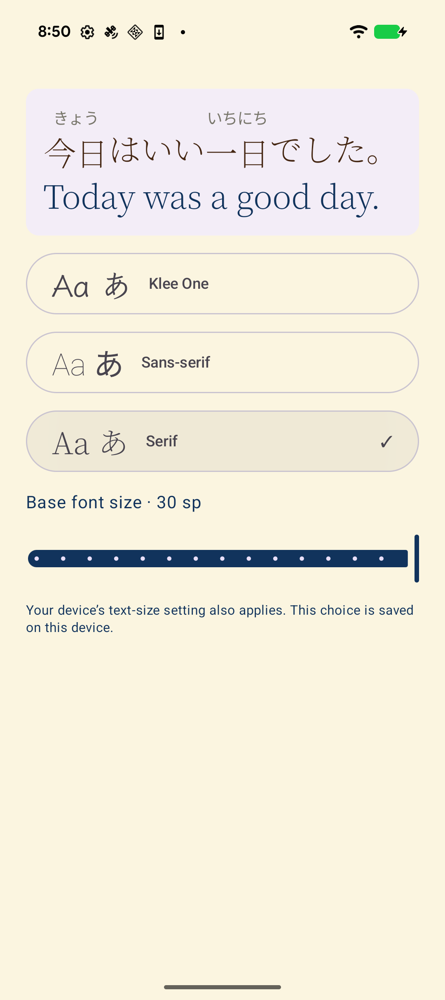
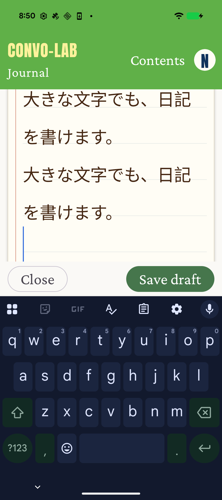
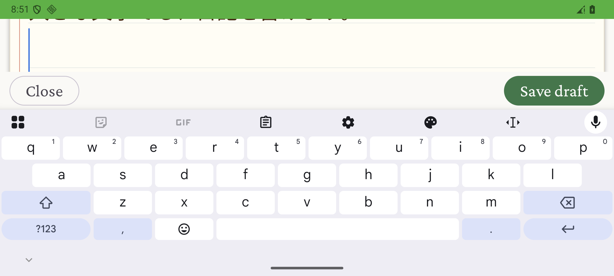

# Journal appearance and keyboard layout

Implements #14 against the stable iOS reference at `6dae16a`. Settings → Journal → Appearance previews and saves Klee One, sans-serif, or serif and a base size of 16–30 scaled points. The preference applies to paper, feedback/readings, final edits, and conversation replies. Android accessibility text scaling is additive. Preferences are device-local and contain no account or journal data; damaged values recover to defaults.

The iOS Journal deliberately forces its light paper palette. Android keeps that treatment and uses dark system-bar icons. Noto Sans JP and Noto Serif JP substitute for Apple-only system Japanese fonts; Klee One is shared. Noto Serif JP is from google/fonts commit `8b0a1d0f5983c89bc2b93f1b5fb55f9e252744b5`, `ofl/notoserifjp/NotoSerifJP[wght].ttf`, under the bundled OFL license. SHA-256: `2fd527ba12b6a44ec30d796d633360da0aeba6c5d4af1304ce12bb4dc15a7dfc`.

When the keyboard is open and the available writing viewport is under 240dp, the decorative header yields space to writing and the action row uses compact spacing. Buttons remain readable above the keyboard. Contents and Settings return when the keyboard closes, even in a short split-screen window. The Compose fixture explicitly uses edge-to-edge and resize-on-keyboard, matching the real Activity.

## Verification

- Build, lint and 105 JVM tests passed on the initial appearance baseline.
- Fourteen UI tests passed on Pixel 10a: appearance (2), notebook (4), feedback (3), conversation (3), settings (2).
- Two appearance tests passed in an API 36 emulator with a 2400×1080 landscape viewport. Tests assert action and editor visibility, a minimum readable action height, keyboard clearance, preference restoration and draft retention with a 30sp journal font at 1.6× system text scale.
- Screenshots below were inspected. Full TalkBack navigation and wider small-screen/device-dark acceptance remain in #17; these captures do not claim those checks.

