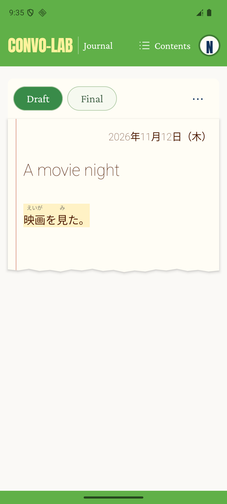
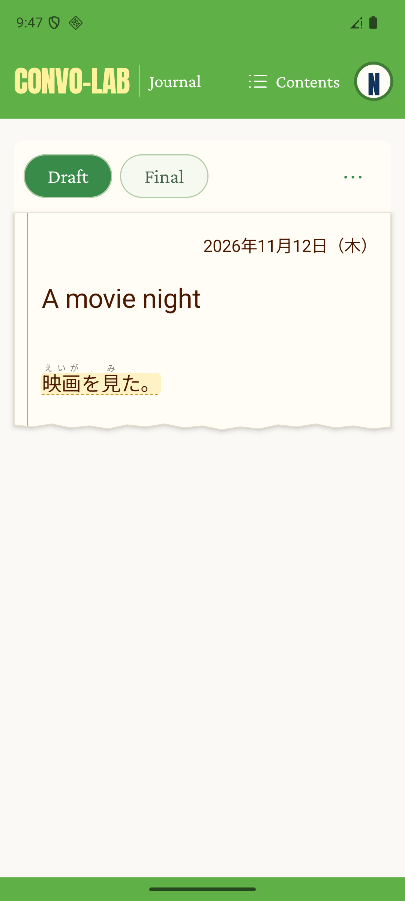
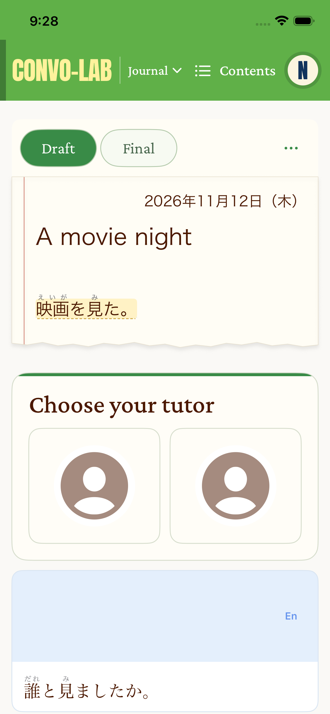
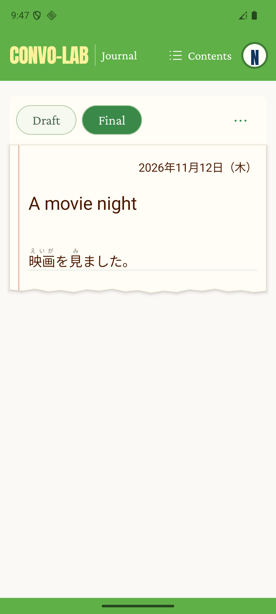
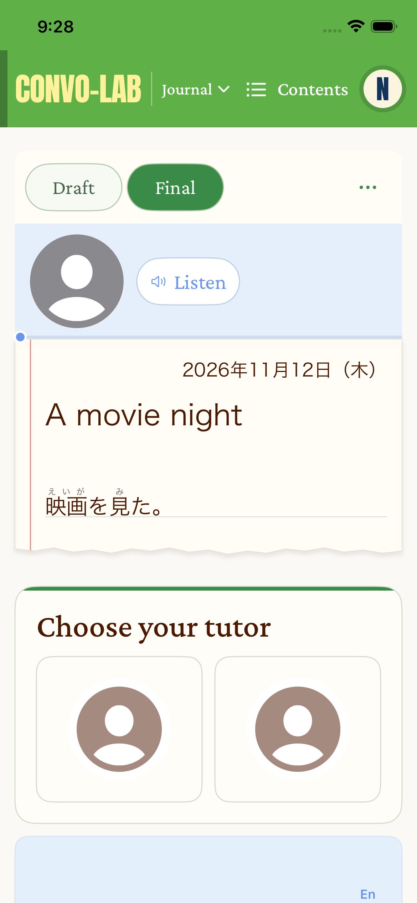
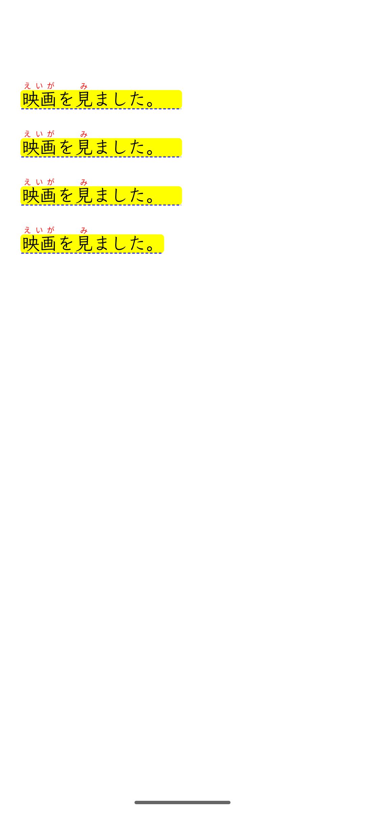

# Journal furigana comparison, 22 November 2026

Reference: iOS `aceb8fbd6560153d2337250634e1df92d77c188d` on the iPhone 16e simulator.
Android before: `e8f30133766169db78294c9270218c660b4462d8` on API 36.
This pass uses the Android emulator, as requested; it does not claim Pixel validation.

## Findings and fixes

| Area | Difference | Change |
| --- | --- | --- |
| Furigana | Readings floated above the base text because two complete font metric boxes were stacked. | Measure visible glyph bounds, overlap only empty metric space, retain full child boxes to prevent clipping, and keep kanji aligned with adjacent kana. |
| Ruby size and distribution | Readings were 48% of the journal size and bunched over short words. | Use iOS's 42% size and distribute short readings over the base word. |
| Corrections | The background covered the readings and the entire line box. | Rounded highlights stay around the base text; optional edits have a dashed underline and corrections a solid underline. Wrapped segments retain separate per-line highlights and tap targets. |
| Journal fonts | Variable Sans and Serif files defaulted to Thin and Extra Light, especially visible in Latin headings. | Explicit regular weight for both fonts. |
| Reviewed paper | Oversized title/date, excess minimum height, missing rules and border. | Match 27 pt title, 17 pt date, heading spacing, margins, bottom padding, thin border, and paper line pitch. Final text has a bottom rule; draft rules stay between rows, matching the reference captures. |
| Toolbar and audio | Overflow action was navy, active narration yellow, and narration-picker help too dark. | Use the iOS green overflow action, pale blue narration highlight, and muted help caption. |
| Correction popover | Paper line spacing could propagate into a suggestion. | Keep popover typography independent of notebook rules. |

## Reproducible comparisons

Draft captures on both platforms use the same fixture sentence and Sans at 20 pt.
Android's Noto Sans JP and iOS's Hiragino Sans are platform font counterparts,
not identical glyph outlines. The Android viewport is approximately 411 dp wide;
iOS is 390 pt wide. System bars and the admin-only iOS section chevron differ.
The iOS fixture includes tutor cards and an audio header; the isolated Android
feedback fixture does not attach tutor or audio controllers. Audio controls are
verified separately with the real-player fixture. The final Android fixture
uses the polite sentence ending, while the iOS fixture retains its original ending.
These fixture differences are not application regressions.

`FeedbackUiTest` accepts instrumentation arguments `journalFont` (`Klee`, `Sans`,
`Serif`) and `journalSize` (16–30) so future captures can use matching preferences.

| Before Android | After Android | iOS reference |
| --- | --- | --- |
|  |  |  |

| Android final | iOS final |
| --- | --- |
|  |  |

## Regression coverage

The pixel-based spacing check fails on the original implementation (21 px of
blank space at Klee 16 on this emulator). It checks all three fonts at 16, 20,
and 30 pt, at normal and 1.6× text scaling: visible readings, no collision,
compact spacing, unclipped text, and a shared baseline with adjacent kana.
A second check covers wrapped highlights, inline taps, and known-kanji hiding.
Existing tests exercise compact correction popovers, large text, keyboard bounds,
feedback, audio, conversation replies, appearance, and settings.

Debug/release builds, lint, and 155 JVM tests pass. All 23 targeted API 36
emulator tests pass. Five iOS simulator reference tests pass; iOS source is
unchanged. CodeScene MCP covers all 12 changed Kotlin files with score 10.0,
no findings, no declines, and no unsupported files.

