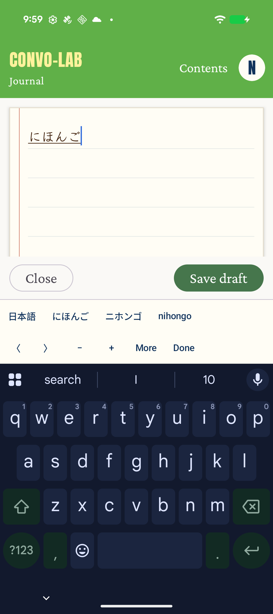
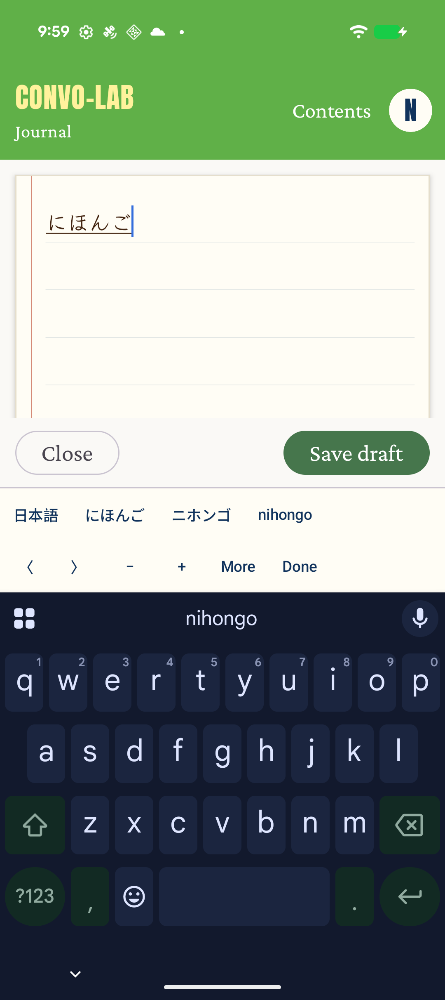
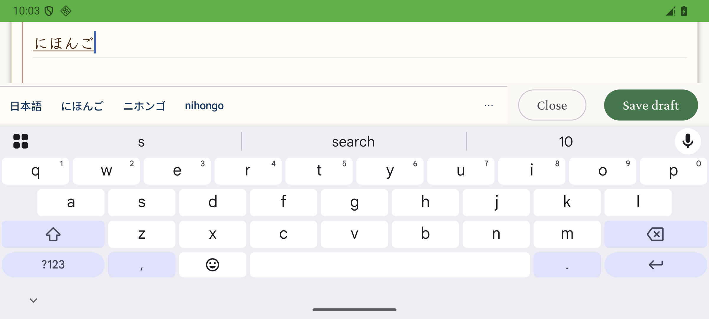

# Journal Japanese input

The Journal entry, tutor reply, and final-text editor share native Compose input. A device-local chooser distinguishes an English keyboard (built-in romaji conversion) from a Japanese device keyboard. Settings → Journal → Keyboard changes that choice and offers confirmed reset of this account’s local learning.

Kana composition is synchronous. Neural suggestions run separately after a 35 ms debounce, cancel obsolete native work, and are applied only to the matching composition revision. Choosing a candidate updates the document synchronously before save/submit. Paste remains literal, including English and emoji; device-keyboard mode bypasses conversion. Space cycles choices, Enter accepts, and the section arrows and −/+ controls adjust phrase boundaries. Expanded lists render only visible candidates.

Each account owns its native handle and learning directory under Android noBackupFilesDir. All owners share the native operation lock. The restart/isolation/reset contract verifies that a learned choice survives reopening, does not affect another account, and returns to baseline after reset. Sign-out/disposal cancels the account worker and waits for native teardown before its handle can be reused.

The model, dictionary, attribution notices, and ARM64/x86_64 libraries are packaged for both debug and release. Public test fixtures and the playground activity remain debug-only. Both APK variants build; the release ZIP was checked for the model, dictionary and both JNI libraries, and absence of debug fixtures. Release dex merging required increasing the Gradle heap from 2 to 4 GiB. CI now builds release as well as debug.

Validation: 120 JVM tests; six keyboard/native-owner Android tests on Pixel 10a and API 36 emulator; sixteen integrated Journal/feedback/conversation checks on both devices; eight keyboard/feedback checks in a 2400×1080 landscape emulator. Actual English Gboard key taps are tested in addition to text-field injection. Screenshots below use public fixture writing and were inspected for keyboard overlap. The short-screen footer combines actions and candidates into one row; the ellipsis switches to section tools.

The immediate-model microbenchmark and native inference timings are reported separately in [composition](composition.md) and [performance](typing-performance.md). Native phrase inference still exceeds the 150 ms p95 target; these UI checks do not claim an end-to-end latency measurement. Full background/process-death and accessibility parity checks remain in #16/#17.

Lifecycle follow-up: the keyboard owner now survives activity recreation through a ViewModel. Account changes close and join the previous owner before creating another engine. Confirmed learning drains before native destruction, and the engine teardown is a child of the owner rather than a detached coroutine. Three lifecycle/cancellation/failure tests pass on both Pixel and emulator, and an activity-recreation/account-switch regression passes on the emulator. Keyboard choice remains a device preference intentionally; learned writing is account-scoped.
