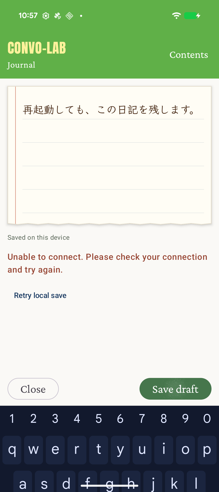
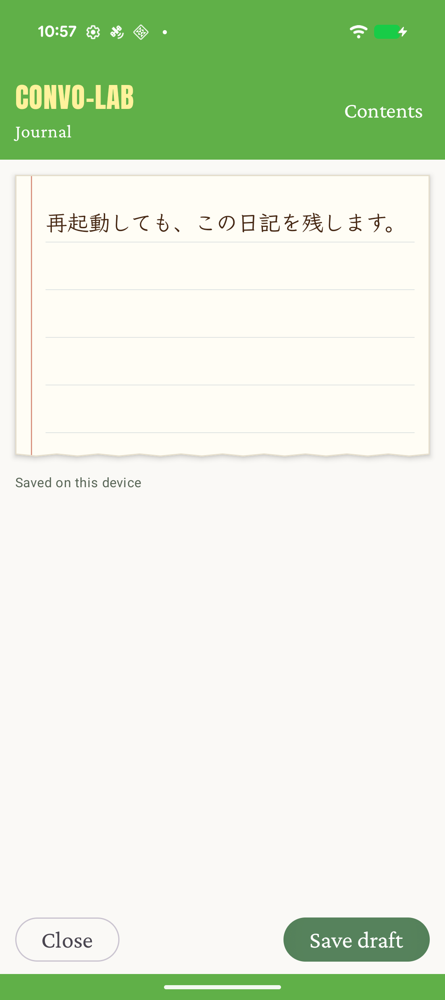
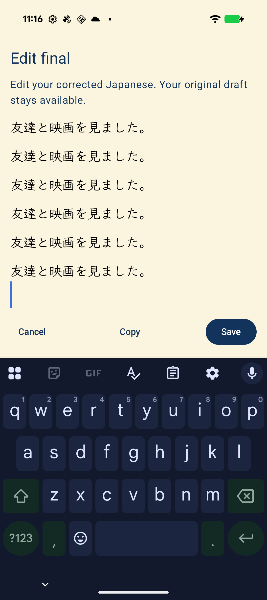

# Journal lifecycle and expired sign-ins

The Journal keeps account-scoped writing, pending save identities, clarification checkpoints, final-edit checkpoints, conversation drafts, and display choices on disk. Account owners finish their last local write before a replacement account opens its files. A lost response retries the original entry ID, edit ID and expected version instead of making another entry.

## Real process restart on Pixel 10a

`JournalProcessRecoveryTest` has two independently launched phases. The seed phase enters Japanese writing through the Notebook UI and simulates a lost save response. After Android force-stops the app, the resume phase verifies a different process ID, restores the exact writing, and retries the same request identity. Its fixture server acknowledges that request; the pending marker then clears. Both phases passed on the physical Pixel. The ordinary CI variant also exercises the same disk reopen path within one process.

These tests use account 101 in a dedicated `journal-process-fixture` directory and a local transport. They do not modify a real account or device network settings.

## Expired sign-in

A 401 from a Journal, settings, audio or account-deletion request returns the matching account to sign-in and removes its saved credentials. Its local writing remains available after signing back in. A late 401 from an old token cannot sign out a replacement account. Other HTTP failures keep the current session. If credential removal fails, the message reports that failure without claiming the saved copy was removed.

Verification includes matching-session expiration and re-login, replacement-account protection, credential-storage failure, and transport status discrimination. Existing tests cover account-switch final writes, corrupt-file recovery, offline drafts, interrupted clarification/final edits, Activity recreation, retained keyboard ownership and background audio. Android intentionally supports background playback; Bluetooth, calls and listening quality remain human acceptance checks.

## Keyboard and full-screen windows

The final editor and Settings explicitly let Compose handle system and keyboard insets. This prevents Android from panning the whole dialog above the status bar while Compose also reserves keyboard space. A long-entry regression checks that the final-editor heading stays visible and Save stays above the keyboard. Dialog status-bar icons use dark foregrounds over the light paper. See Android’s [DialogProperties contract](https://developer.android.com/reference/kotlin/androidx/compose/ui/window/DialogProperties) for explicit inset ownership.

## Integrated validation

At 7e62078, all 89 instrumented tests passed on both Pixel 10a and the API 36 emulator, alongside 136 JVM tests, lint and debug/release builds. The complete suite covers real native inference, learning, cancellation, Gboard, Journal workflows, account isolation, Settings and real Media3 playback using public fixtures. APK inspection verified the 72,298,816-byte model, 3,393 dictionary files, ARM64/x86_64 libraries, production API and no backup/cleartext traffic. Release excludes test fixtures. Final merged-main installation is tracked in #17.

## Remaining acceptance

Sign in on the Pixel with a real account, write and submit an entry, complete any clarification, compare corrections and the final version, answer a tutor question, play narration, change appearance and synchronize WaniKani. Check TalkBack and personal font preferences. Public fixtures validate interface and contracts; they do not prove the user's live account or listening experience. The first expanded neural suggestion request can still take several seconds; immediate kana entry does not wait for inference and cancellation remains available.
