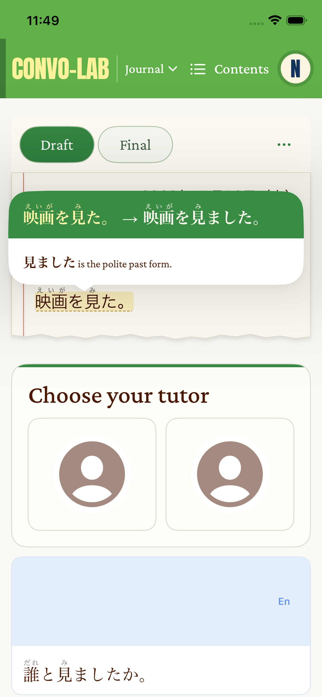
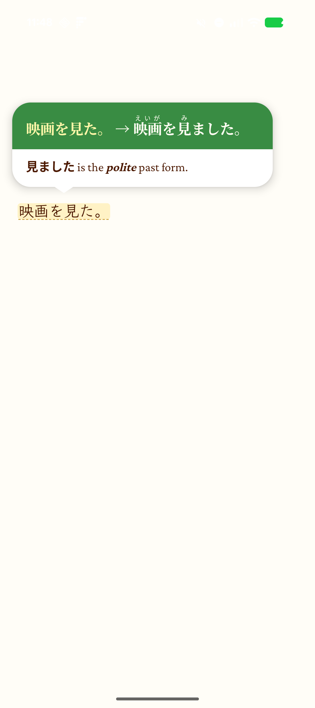
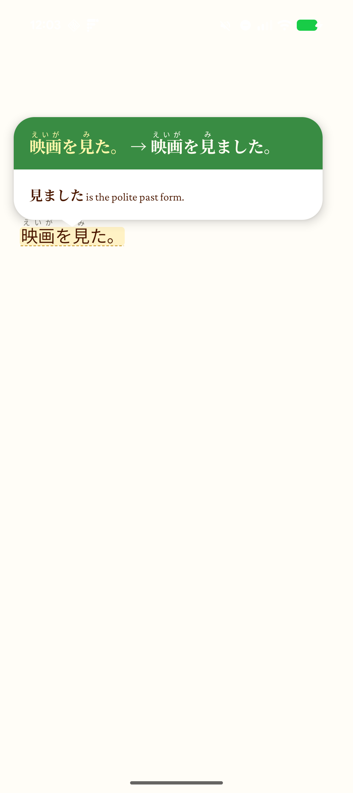
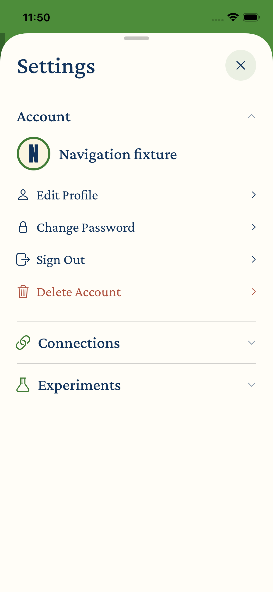
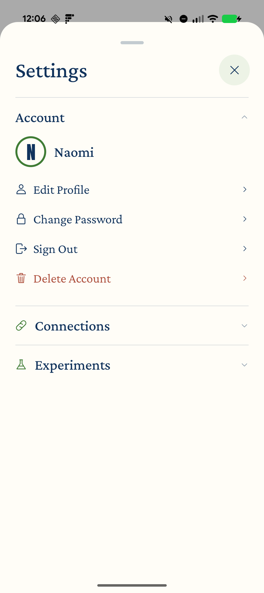
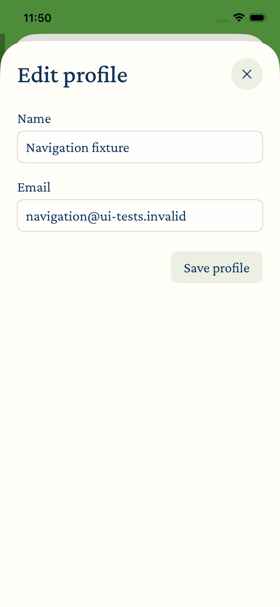
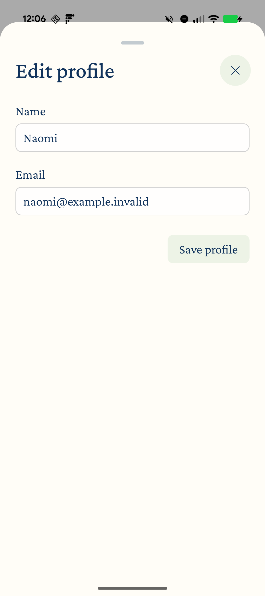

# Correction popovers and Settings comparison — 2026-11-22

Reference: iOS `aceb8fbd6560153d2337250634e1df92d77c188d`, iPhone 16e simulator, iOS 26.2, 390-point width. Android: Pixel 10a, Android 16, 1080×2424 at 420 dpi (about 411 dp wide). Compare spacing in points/dp rather than stretching both screenshots to the same screen width. Fixtures use reserved accounts and fake services; no personal account changes were sent.

## Correction popovers

| iOS reference | Pixel before | Pixel after |
| --- | --- | --- |
|  |  |  |

The updated fixture uses the same original/replacement readings and explanation as iOS. The earlier Android screenshot omitted original readings and used italic emphasis, so those content differences are fixture changes. Android isolates the correction component; iOS shows it within a complete entry. Absolute screen position and the surrounding page are not a comparison of the same scene.

Changes:

- Match the 360-point/dp maximum width and anchor the pointer to the base text row rather than the full ruby line box.
- Size Latin explanation text to 80% of the explanation size, with full-size bold Japanese serif text and punctuation. Preserve Latin emphasis and color exact Japanese replacement terms green.
- Suppress repeated readings already visible in the correction header; keep readings for new words. Match mixed-script sentence gaps without removing paragraph breaks.
- Make inline furigana honor each text run's font and size while retaining cached measurements and the existing ink-based spacing.

Noto Serif JP is the Android counterpart to iOS's Hiragino Mincho. Glyph outlines and line breaks can differ. Both use the same sizing rules; Japanese glyphs and readings remain unclipped at journal sizes 16, 20, and 30 and at enlarged system text.

## Settings

| iOS reference | Pixel after |
| --- | --- |
|  |  |
|  |  |

Changes:

- Use the actual medium-weight Crimson Pro variation for headings; match smaller row icons, account action spacing, and destructive-action color.
- Use 44-dp minimum rounded fields with the iOS padding and border. Fields grow with accessibility text. Retain secure password input, validation, visible focus outlines, and field-state clearing. The disabled password action announces its requirements.
- Remove the always-visible password hint to match the reference form; validity still controls submission.
- Keep WaniKani inline, with right/down disclosure chevrons, label/value connection rows, a localized last-sync date, and a placeholder token field. Reload when the disclosure opens, including while disconnected; show Refresh connection when an error needs recovery. Announce the disclosure state to accessibility services.

Native sheet presentation, status/navigation bars, keyboard chrome, and different fixture account names remain platform/content differences. Android keeps its existing success/error messages.

## Verification

The Pixel tests exercise correction dismissal, small/normal/large journal type, long scrollable explanations, account appearance controls, profile/password edits with the keyboard open, WaniKani connect/disconnect, and large-text profile submission. All account operations use in-memory gateways. Unit tests cover mixed Japanese/Latin emphasis, duplicate reading suppression, replacement coloring, sentence spacing, and inert unsupported markup.

The shared ruby rendering checks also exercise all journal fonts/sizes, distributed readings, wrapping, and hidden known-kanji readings. Build, lint, unit, CodeScene MCP, GitHub review, and CI results are recorded on the PR.
