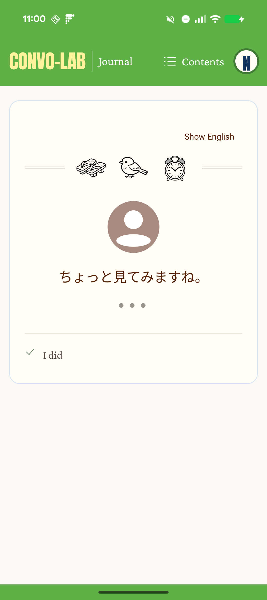
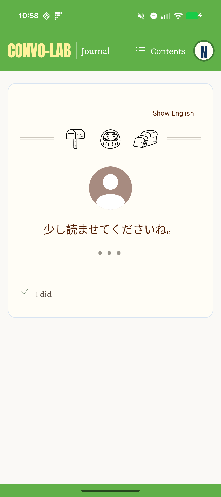
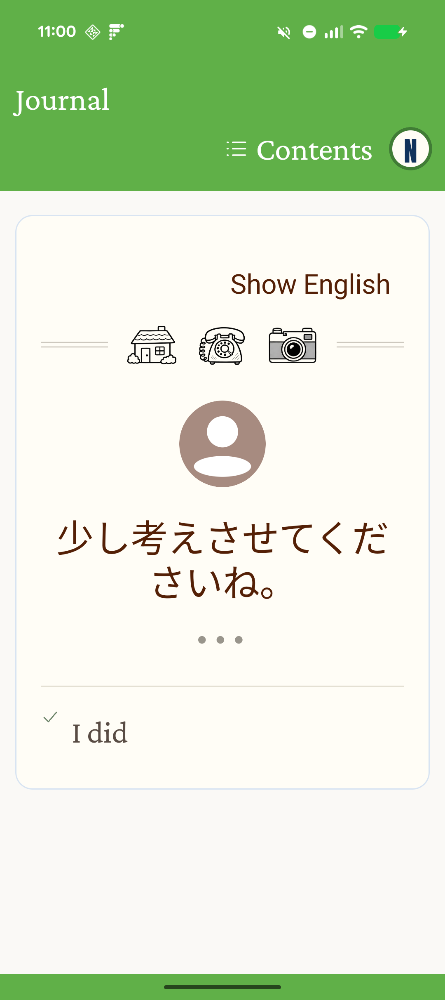
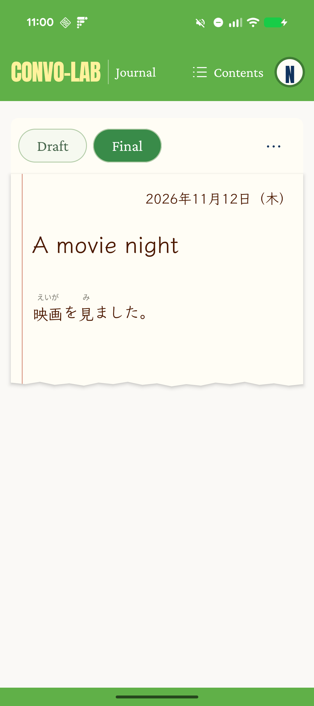
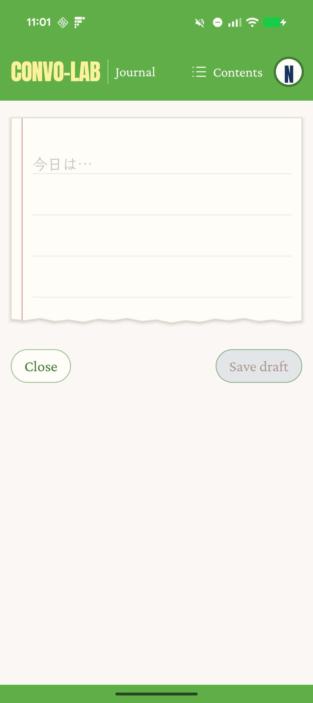
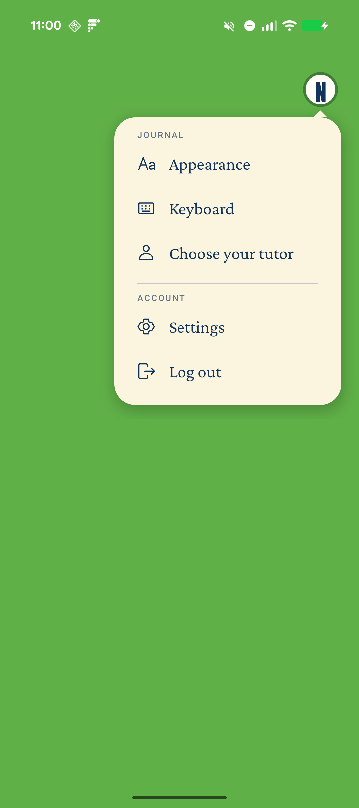
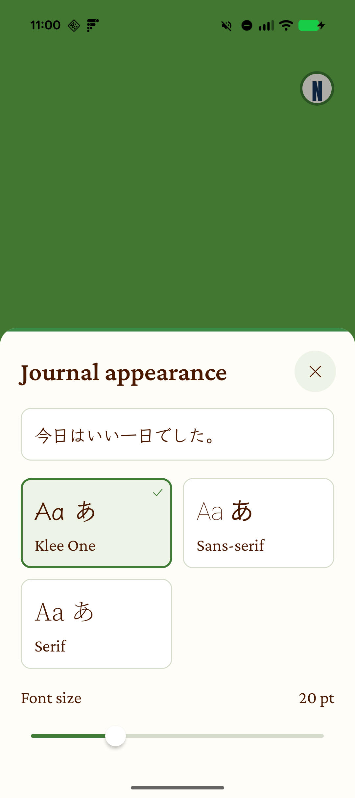

# Submission and visual comparison follow-up

## Submission failure

The backend generates a title when feedback finishes and increments the entry
version in the same transaction. Android previously rejected that analysis read
because the returned version differed from the submitted version, producing
“This entry changed” even when the body was identical.

Analysis reads now accept a nondecreasing version only when both entry identity
and writing match. The original submission version remains the retry identity;
clarification mutations, genuinely changed writing, older responses, and final
edit revision checks retain their existing conflict guards. Regression tests
cover both generated-title completion and a real body change during polling.

The affected live Pixel entry was reopened successfully: the server result was
ready, Draft and Final were visible, and the false-conflict message was absent.
No entry was deleted or resubmitted as part of this recovery check.

## Waiting and appearance

- Original desktop illustration atlases (40 drawings), staggered fades, animated
  dots, bilingual phrases, selected tutor, saved answer, and delayed reassurance.
- Reduced Motion displays static art. Animation updates pause in the background.
- Waiting and clarification replace the draft, matching iOS; submission dismisses
  the keyboard so the response is not hidden behind it.
- Notebook line spacing, first-line alignment, four-line minimum writing area,
  paper padding, and shallow torn edge follow iOS.
- Account menu order, labels, cream background, caption spacing, and pointer now
  match the iOS popover. Appearance preview/cards use brown ink; radio choices use
  Journal green; writing placeholders use neutral gray.

Artwork provenance: `convo-lab` commit `e170f346`,
`client/public/journal/illustrations` and `journalThinkingIllustrations.ts`.
The iOS waiting counterpart is tracked in
[convo-lab-ios PR #370](https://github.com/andyroo2000/convo-lab-ios/pull/370).

## Verification

Debug/release builds, Android lint, and 150 JVM tests pass. Pixel 10a coverage
includes 21 UI tests for feedback, generated-title submission, double text size,
notebook, keyboard bounds, appearance, and tutor selection. A separate waiting
flow also passes with the device animation scale disabled; the original setting
is restored afterward. PR CI runs the complete emulator suite.

CodeScene MCP covers all 28 changed Kotlin files with no findings or declines.
`AccountMenu` and the static illustration table return no numeric score.

The screenshots below use isolated fixtures. iOS appearance captures use Serif
at 28 pt; Android uses Klee One at 20 pt. Those deliberate fixture preferences,
Android system chrome, and the smaller phone viewport are not visual defects.
The iOS waiting capture is a conversation reply; Android's is a root submission.
The isolated notebook fixture exercises saving without a feedback controller, so
it labels its action “Save draft”; the production Journal action is “Submit”.

