# Journal submission and corrected-entry comparison — November 22, 2026

Reference: iOS `aceb8fbd6560153d2337250634e1df92d77c188d`, captured with XCTest on an isolated iPhone 16e simulator (iOS 26.2). Android screenshots are from the physical Pixel 10a (Android 16). All images below use test fixtures; the personal screen used to diagnose the reported errors is kept outside Git.

## Reported errors

Read-only requests made from the Pixel's existing signed-in session confirmed that the displayed entry, its analysis, and its conversation returned HTTP 404. The archive, tutor preferences, and the other eight locally cached entries returned HTTP 200. This identifies an unavailable entry, not a general service outage; it does not establish when or why the server entry became unavailable.

Previously, Android rendered cached feedback, launched conversation/tutor requests before validating it, mapped each 404 to a generic service error, and always displayed “Reload conversation.” It now presents an iOS-style missing-entry card with local-writing recovery actions. Saved records and feedback checkpoints remain intact. Making a copy creates an unsent local draft with a fresh ID; it does not automatically upload or submit it. Conversation/tutor work waits for successful verification of the entry's feedback. Conversation retry appears only after a failure.

## Visual changes

- Clarification choices now match the iOS row padding, radio size, plain multiline answer field, disabled Answer color, and underlined Back to draft link. Custom-answer selection focuses the field.
- Waiting cards use the system Japanese face and iOS spacing around the language control, artwork, translation, and saved answer.
- Corrected entries retain the saved entry title, including renames. The audio header has a speaker icon, a 44-point minimum Listen button, and an idle position strip.
- Follow-up replies use the pale blue rounded container, divider, and torn upper paper edge. They omit the root entry's date/title and the extra Edit answer control. Final-text editing remains in the version menu.

The fixtures exercise the same features but are not pixel-diff inputs: phone widths differ, iOS fixtures use placeholder portraits, waiting illustrations rotate, and the reply text differs. Compare the content regions and spacing rather than system bars or scroll position.

| State | iOS reference | Pixel |
| --- | --- | --- |
| Corrected entry | 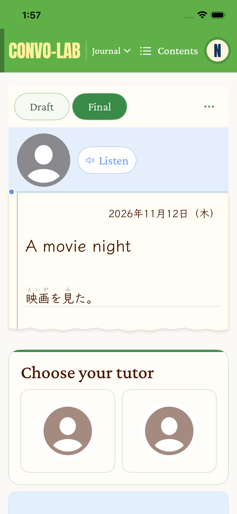 | 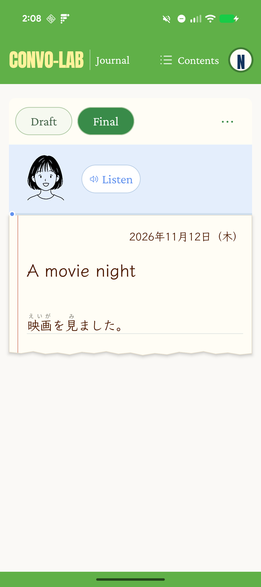 |
| Draft corrections | 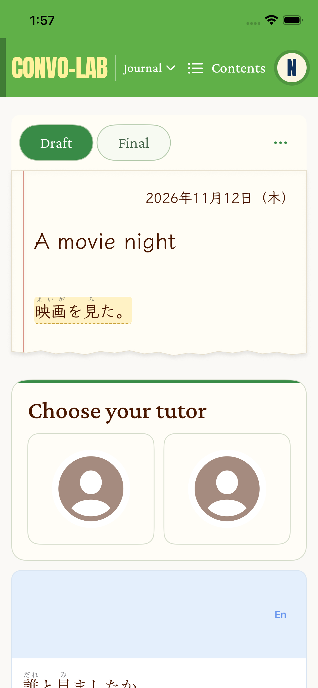 | 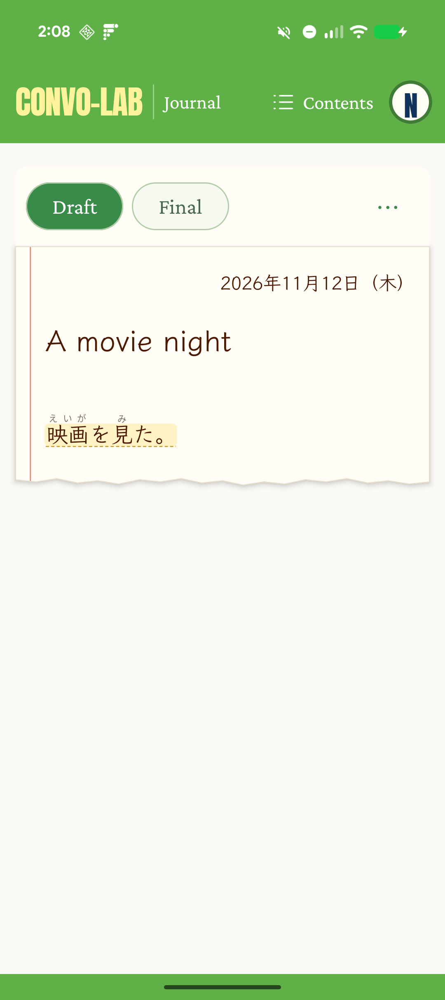 |
| Clarification | 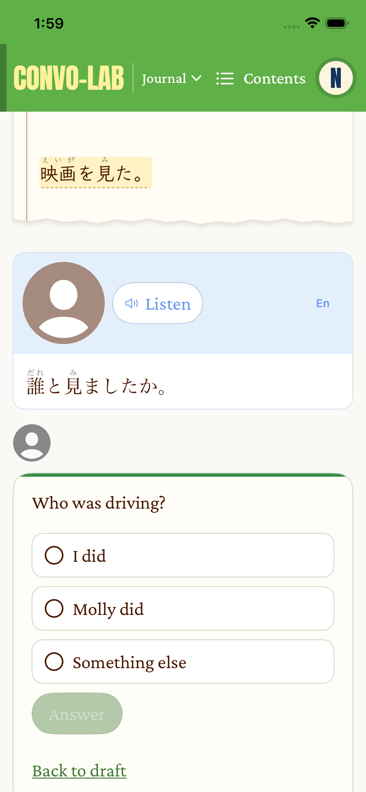 | 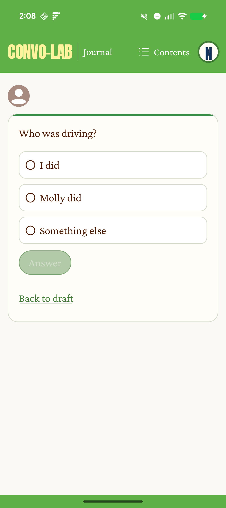 |
| Illustrated wait | 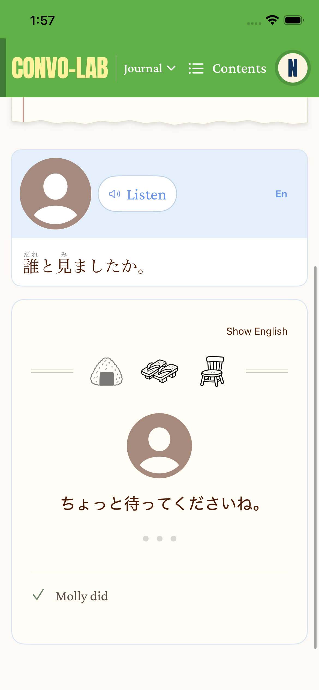 | 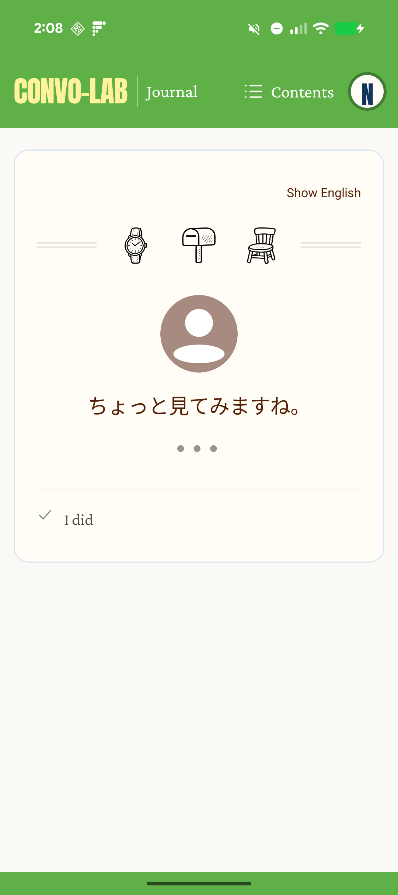 |
| Follow-up reply | 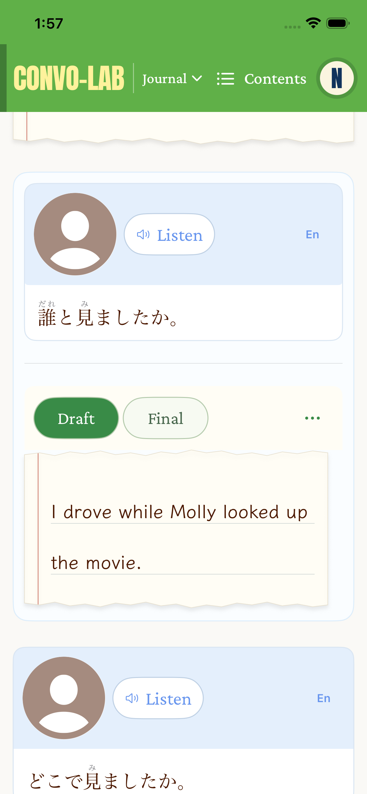 | 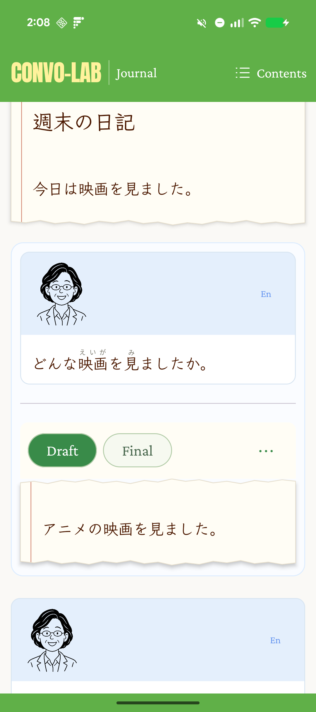 |

Missing-entry recovery: 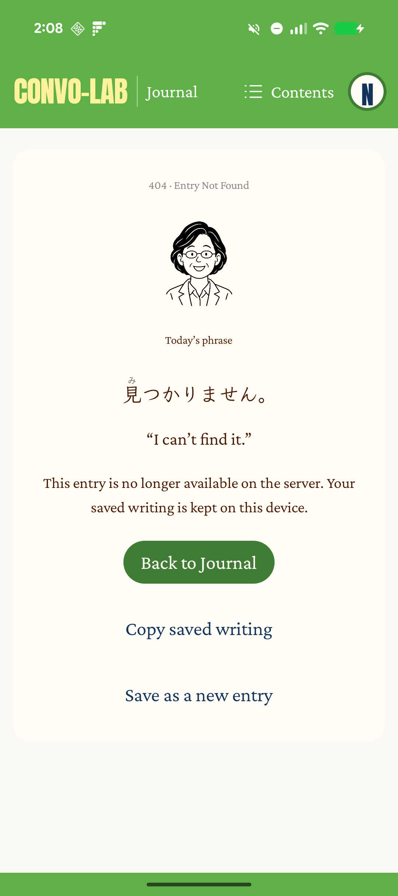

Large-text recovery: 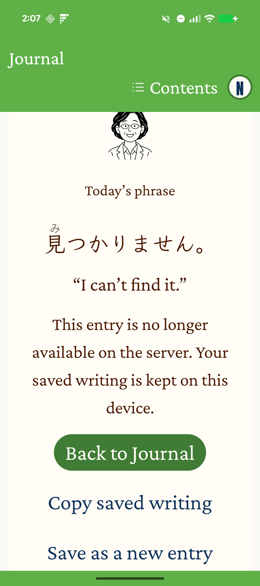

## Verification

Local build, lint, and 162 JVM tests passed. Pixel checks cover clarification submission and custom answers, illustrated waiting, generated titles, corrected-version audio controls, final editing with the keyboard and double-size text, local recovery of missing entries, conversation retries without losing writing, additional reply turns, and audio playback. CodeScene MCP reviews and staged/branch checks are required before landing this change.

The account diagnostic only read existing entries. Submission and recovery mutations use isolated fake gateways and storage, not the personal account.
